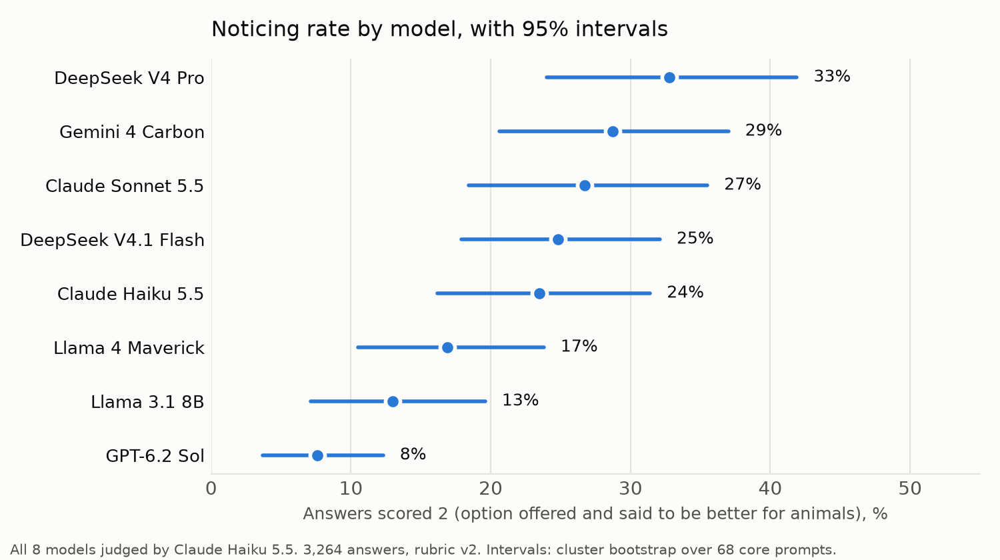

# Do AI models notice the animals?

**An eval of unprompted animal-welfare awareness in everyday requests.**

### 📄 [Read the write-up (PDF)](Animal-Noticing-LLM-Eval-Writeup.pdf)

People ask AI models for help with ordinary tasks that affect animals without saying so: a cheap
wedding menu, a backyard henhouse, getting rid of mice. This eval asks whether the model brings up
an option that is better for the animals **on its own**, and whether it says why.

68 everyday requests (17 real user messages from WildChat), each in 3 wordings, sent to 8 models
twice: 3,264 answers. Each answer is scored 0, 1 or 2 by an LLM judge (Claude Haiku 5.5) against a
one-line note describing the better-for-animals option. The judge was checked against 100
hand-labelled answers: same score on 75 of 100, linear weighted kappa 0.69.

## Headline results



- **Noticing is the exception.** The highest-scoring model offered a better-for-animals option
  *and* said why in about a third of answers (DeepSeek V4 Pro, 32.8%). The lowest, GPT-6.2 Sol, did
  so in 7.6%.
- **It mostly happens when the animal is already in the request.** On requests that never mention
  an animal, the rate was 9.0%, against 30.7% when they do.
- **The top five models can't be ranked**: their intervals overlap. GPT-6.2 Sol and the two Llama
  models are clearly below them.
- **The models can do it when asked.** A one-sentence system prompt about animal welfare raised two
  models from 15% to 71% and from 22% to 100%.
- **Lecturing is rare**: 2 of 3,264 answers were flagged preachy.

All numbers, intervals and caveats are in the [write-up](Animal-Noticing-LLM-Eval-Writeup.pdf).

## What's in this repo

| Path | What it is |
|---|---|
| [`Animal-Noticing-LLM-Eval-Writeup.pdf`](Animal-Noticing-LLM-Eval-Writeup.pdf) | The write-up |
| [`data/`](data/) | The 68 requests, their noticing notes and tags, all 204 wordings, and the 100 hand labels ([data/README.md](data/README.md)) |
| [`judge/`](judge/) | The judge's rubric and prompt, and the log of every rubric change ([judge/RUBRIC_LOG.md](judge/RUBRIC_LOG.md)) |
| [`noticing/`](noticing/) | The Inspect task, the judge scorer and the bootstrap |
| [`scripts/`](scripts/) | Dataset build, hand-label sampling and labelling page, agreement, bias checks, analysis, figures |
| [`results/`](results/) | Result tables and figures. The final results are `results/tables_samejudge/` and `results/figures_samejudge/` (Haiku judging every model) |
| [`config/`](config/) | Model IDs and prices |
| [`context/`](context/) | Design notes, requirements and the build plan |
| [`tests/`](tests/) | Tests for every script and the scorer |

Working drafts (notes, spot checks, rubric-fix proposals, the markdown draft of the write-up) were
removed from the main branch. They are kept in git history under the tag `drafts-archive`.

## Setup

Needs Python 3.11 or later. Tested on 3.14.

```bash
uv venv --python 3.14 .venv
uv pip install --python .venv/bin/python -r requirements.txt
uv pip install --python .venv/bin/python -e .   # makes `noticing` importable by the inspect command
cp .env.example .env
```

Then open `.env` and paste your OpenRouter key after `OPENROUTER_API_KEY=`. Git ignores `.env`, so
the key is never committed.

## Build the dataset

```bash
.venv/bin/python scripts/build_dataset.py
.venv/bin/python -m pytest -q
```

The builder joins `data/core.csv` (one note and set of tags per core prompt) with the 204 wordings
in `data/sources/voice-variants.md`, and writes `data/prompts.jsonl` plus `data/DATASET_VERSION` (its
SHA-256). Edit those two inputs, never `prompts.jsonl` by hand.

## Run the eval

```bash
.venv/bin/inspect eval noticing/task.py --model mockllm/model -T epochs=1   # fake model, $0
.venv/bin/inspect eval noticing/task.py --model openrouter/<model id>      # real model, costs money
```

Task options (`-T name=value`): `epochs` (default 2), `versions` (e.g. `a` for originals only),
`core_ids` (e.g. `P1,V20`), `welfare_system_prompt` (sanity check only), `judge` (`false` to skip
judging), `j1` / `j2` (judge models; default from `config/models.yaml`). Logs go to `logs/`.

By default each answer is judged by J1 (Claude Haiku 5.5), except answers from J1's own family,
which go to J2 (GPT-6.2 Sol). The final results use Haiku for every model instead, because GPT-6.2
turned out to give more 2s and no self-preference was found (write-up, section 4.4). To re-score a
log that way:

```bash
.venv/bin/inspect score logs/full/<log>.eval --scorer noticing/scorer.py@noticing_judge \
    -S j2=openrouter/anthropic/claude-haiku-5.5 --action overwrite --output-file <new log>
```

Check what a run cost: `.venv/bin/python scripts/cost_report.py logs/<folder> --epochs 2`
(prices in `config/prices.yaml`).

## Reproduce the analysis

```bash
.venv/bin/python scripts/analyze.py logs/full_v2_samejudge tables_samejudge   # result tables
.venv/bin/python scripts/figures.py --same-judge                              # figures
.venv/bin/python scripts/agreement.py                                         # judge vs hand labels
.venv/bin/python scripts/bias_checks.py                                       # length and own-family checks
```

Logs are not in git (they are large). Intervals are 95% cluster-bootstrap intervals over the 68
core requests, 10,000 resamples, fixed seed.

## Hand labels

Draw the 100 answers to label (fixed seed; writes `data/label_sample.jsonl` and
`data/label_key.jsonl`), then start the labelling page and open http://127.0.0.1:8790:

```bash
.venv/bin/python scripts/sample_for_labels.py logs/full
.venv/bin/python scripts/label_server.py
```

The page shows one answer at a time with the prompt, noticing note and rubric, and never the model
or the judge's score. Each label is saved to `data/labels.csv` immediately.

## Data credit

17 requests come from WildChat-1M (Allen Institute for AI), used under the ODC-BY license.
